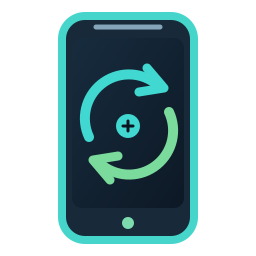

<p align="center"></p>

<h1 align="center">DOOGEE S55 · LineageOS 18.1</h1>

<p align="center"><strong>Give your rugged S55 a second life with Android 11 and Google Play.</strong><br>
A device-specific, guided offline installation kit with tested MediaTek compatibility fixes.</p>

<p align="center">
  <a href="https://github.com/GodsQuantum/doogee-s55-android-11/actions/workflows/lint.yml"></a>
  
  
  
  <a href="LICENSE"></a>
</p>

<p align="center"><strong>English</strong> · <a href="README.fr.md">Français</a> · <a href="README.zh-CN.md">简体中文</a></p>

---

## 🚀 Install in one guided command

**A prepared offline kit** lets a Linux computer take a compatible *original DOOGEE S55* from Android 8 to LineageOS 18.1 with NikGapps Core. There is no need to memorize individual partition commands.

```bash
cd local-kit
./INSTALL.sh
```

The kit is **not shipped inside the public Git checkout**: LineageOS images, Google packages, OEM recovery/boot/vendor blobs and phone-specific binaries remain local. To assemble it on the maintainer's machine, after obtaining the exact SHA256-pinned files:

```bash
bash scripts/build-s55-lineage18-kit.sh
```

Copy the resulting **whole** `local-kit/` directory to a Linux computer with ADB, Fastboot, Python 3, xz and zstd. The bundled Python progress display makes pv optional. Run `./INSTALL.sh` **as your ordinary user**, not with `sudo`. The installer checks every asset and guides OEM unlocking, TWRP, backups, the safe known GPT conversion, system/vendor flash, GApps, userdata preparation and final Android verification.

**Before installing:** back up personal files; charge the battery to **at least 40%**; enable USB debugging and OEM unlock on stock Android 8. **All apps and internal storage will be erased.** Some physical interaction during unlocking/recovery is unavoidable.

[**Read the complete A–Z installation guide →**](installer/README.md) · [**Safety audit and recovery limitations**](docs/INSTALLER-SAFETY-AUDIT-2026-10.md)

**Conservative performance and battery setup:** [evidence and official references](docs/POWER-PERFORMANCE-2026-10.md).

For read-only checks using an already prepared kit (--verify requires a running Android 11 S55; never use --install to recheck a working phone):

```bash
./INSTALL.sh --plan
./INSTALL.sh --check
./INSTALL.sh --verify
./INSTALL.sh --recovery-check
```

Read-only --recovery-check verifies the original GPT and nine compressed backups locally, without restoring any partition.

## ✨ What the project fixes

| Feature | Validated on the reference S55 |
|---|---|
| **Android 11** | LineageOS 18.1 ARM64 non-SAR boots and reboots normally |
| **Google apps** | NikGapps Core, Play Store, Google Play services and GSF present |
| **Fingerprint** | MicroArray fix plus PHH retention; one enrolled finger survived a full reboot; physical unlock still to verify |
| **Battery readings** | Real voltage and temperature exposed; no fake thermal constants |
| **Thermal HAL** | Real CPU, GPU, battery and case temperatures; SELinux stays **Enforcing** |
| **Legacy peripherals** | MediaTek sensor / gesture vendor compatibility fixes applied |
| **Battery saving** | Native Android battery saver set to 25%; no intrusive background service |
| **Data storage** | Android 11 vendor CE/DE provisioning and full userdata partition restored |

Our reference phone was verified booting, with 100% battery, realistic thermal readings, Wi-Fi/Bluetooth, all three Google packages and functioning HAL services. **Other hardware batches may behave differently**; the installer deliberately stops on unknown GPT, recovery or files.

## 🛡️ Safety and limitations

- **DOOGEE S55 only**, never S55 Lite. Original Android 8/Oreo hardware is the starting point; Android 13+ GSIs need additional non-SAR/SAR porting and **must not be flashed directly**.
- The installer copies the exact vendor/2020 boot image verified on the reference phone. It backs up the target's original partitions first. It never replaces preloader, LK, modem or radio identity/calibration partitions.
- If the charger or an aged lithium battery fails after true deep discharge, **no Android software patch can guarantee recovery**. Low-battery bootloader protections remain enabled.
- Fingerprint HAL now loads without errors; **after enrollment, unlock again after a reboot** to verify the enrolled fingerprint remains usable.
- This kit passed offline SHA256 checks, static analysis and read-only command tests. **A full virgin-stock-to-LineageOS run on a second S55 has not yet been field-validated.** No promise of universal compatibility.

## 📖 Documentation

| Guide | Purpose |
|---|---|
| [Complete offline kit](installer/README.md) | Prepare assets, one-command installation, prerequisites, backups |
| [LineageOS 18.1 migration](docs/LINEAGE18-MIGRATION-ROOT-CAUSE-2026-10.md) | Original on-device system/userdata boot root cause |
| [Battery and thermal corrections](docs/BATTERY-THERMAL-LINEAGE18-2026-10.md) | healthd, thermal HAL, power saving and limitations |
| [MicroArray fingerprint fix](docs/FINGERPRINT-FIX.md) | Why enrollment fails after reboot and its binary correction |
| [ROM choices (EN / FR)](docs/ROM-OPTIONS-EN.md) | Android 13 feasibility and alternative OS research |
| [Historical crDroid guide](docs/CRDROID-LEGACY.md) | Previous reference installation, not the recommended path |
| [Security policy](SECURITY.md) | Reporting problems without publishing device identifiers |

## 🧰 For developers

```bash
make lint
bash scripts/build-s55-lineage18-kit.sh
```

All editable installer sources, hash-pinned patch procedures, recovery scripts and test cases are tracked in Git. Large ROMs, proprietary firmware, encrypted device backups and unique IMEI/NVRAM/NVDATA are deliberately excluded. **Never upload a prepared local kit or device backup to a public issue.**

This is a community project **not affiliated with DOOGEE, LineageOS or NikGapps**. All trademarks belong to their respective owners.

[Contributing](CONTRIBUTING.md) · [Third-party licenses](THIRD_PARTY_NOTICES.md) · [MIT license](LICENSE)
